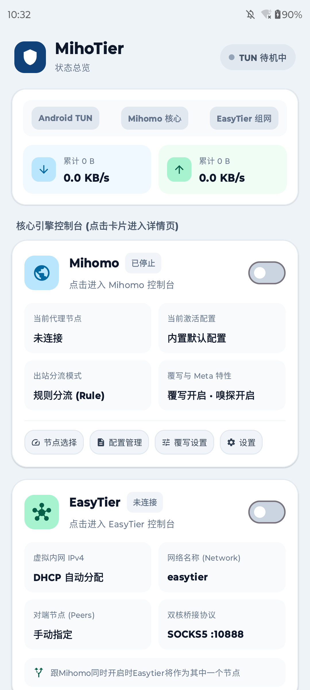
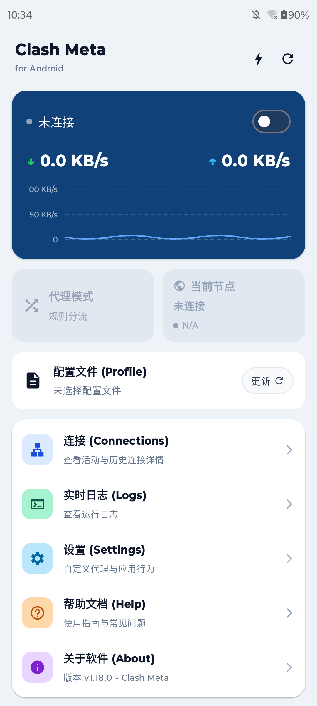
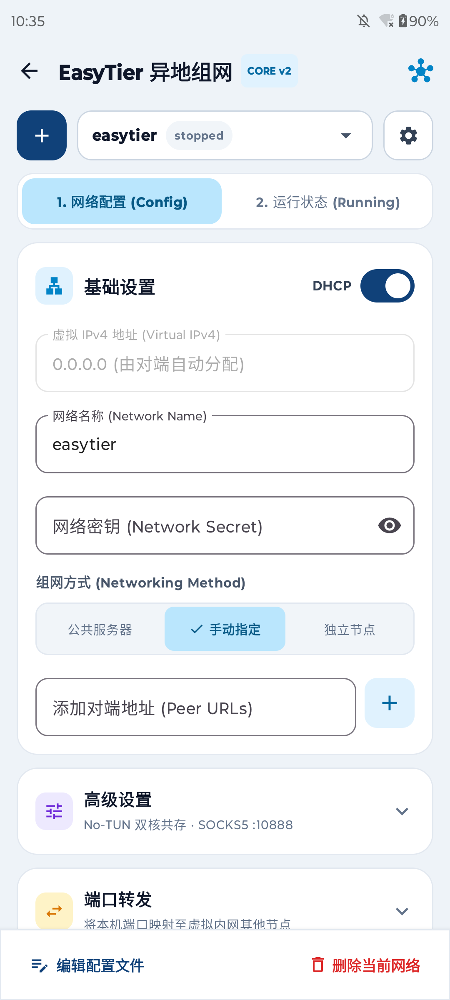

# MihoTier

**MihoTier** 是一款面向 Android 平台的高性能融合网络工具，将 **[Mihomo (Clash Meta)](https://github.com/MetaCubeX/mihomo)** 代理核心与 **[EasyTier](https://github.com/EasyTier/EasyTier)** P2P 虚拟组网核心深度整合于同一 Android 应用中。通过单一 `UnifiedVpnService`，彻底打破 Android 系统同时仅允许开启一个 VPN 的限制，实现科学分流与异地内网互联无缝共存。

###### **代码和这篇东西通统是AI写的**

---

## 📸 界面预览

| 状态总览 (Dashboard) | Clash Meta 控制台 | EasyTier 组网控制台 |
| :---: | :---: | :---: |
|  |  |  |

---

## 💡 核心设计与双核协同原理

在 Android 系统中，系统限制同时只能存在一个活动的 `VpnService` TUN 虚拟网卡接口。MihoTier 采用创新的双核桥接架构解决了该冲突：

- **单核独立运行**：
  - 单独开启 **Mihomo** 时，由其独占 Android TUN 虚拟网卡，提供完整的出站代理与规则分流能力；
  - 单独开启 **EasyTier** 时，EasyTier 直接接管 Android TUN，实现全功能的异地 P2P 虚拟局域网通信。
- **双核无缝共存（推荐）**：
  - 当两者同时开启时，系统 TUN 网卡由 **Mihomo** 全局接管；
  - **EasyTier** 自动切换为 `No-TUN` 模式在后台静默运行，并对外开放本地 SOCKS5 桥接通道（默认端口 `:10888`）；
  - 应用动态识别 EasyTier 虚拟内网网段（CIDRs），并以最高优先级将路由规则注入 Mihomo 分流引擎中；
  - **效果**：访问 EasyTier 虚拟内网设备的流量将自动重定向至本地 EasyTier 核心进行 P2P 穿透通信，其余所有互联网流量正常经由 Mihomo 规则进行代理或直连，互不干扰、无需手动切网。

---

## ✨ 核心特性

### 1. 仪表盘与实时监控 (Dashboard)
- **双核引擎卡片**：直观展示 Mihomo 与 EasyTier 运行状态、当前节点、激活配置与桥接参数，支持一键独立启停；
- **实时流量监视**：精确展示全局及各引擎的实时上下行速率与累计数据吞吐量；
- **系统通知栏驻留**：支持在 Android 通知栏实时显示上下行网速（字节单位自适应 `B/s`、`KB/s`、`MB/s`）；
- **TUN 状态感知**：实时感知 Android TUN 待机、活动与桥接模式。

### 2. Mihomo (Clash Meta) 代理模块
- **出站模式切换**：支持规则分流 (`Rule`)、全局代理 (`Global`)、直接连接 (`Direct`)；
- **节点与策略组选择**：清晰展示代理节点列表、测速延迟与可用性诊断；
- **配置文件管理 (Profiles)**：
  - 支持远程订阅 URL 定时/手动拉取更新；
  - 支持本地 YAML 文件导入与配置切换；
  - 内置等宽字体 YAML 查看与编辑器，支持通过 `FileProvider` 调用外部专业编辑器双向读写同步；
- **连接追踪 (Connections)**：详细列出活跃连接与历史连接，展示源应用、目标域名、分流规则与传输速度；
- **实时结构化日志 (Logs)**：支持 `DEBUG` / `INFO` / `WARN` / `ERROR` / `SILENT` 级别筛选、关键词过滤与自动滚动；
- **配置覆写 (Override Settings)**：支持前置注入自定义 Rules、自定义 Hosts 域名映射、自定义 DNS（Nameserver）与端口/模式覆盖；
- **Meta 专属特性**：
  - **域名嗅探 (Sniffer)**：支持 TLS/HTTP 流量域名提取、纯 IP 目标反查与强制 DNS 映射；
  - **进程追踪 (Find Process)**：精准追踪发出请求的 Android 应用进程；
  - **网络优化**：支持并发 TCP 连接、TLS 客户端指纹伪装（Chrome/Firefox/Safari 等）、内存保守型 GeoData 数据加载器；
- **精细化网络控制**：
  - **分应用代理**：免 Root 基于 Android SDK `PackageManager` 注入 UID 映射，支持黑名单/白名单模式；
  - **网络栈调节**：支持 `System Stack` / `gVisor` / `Mixed` 协议栈切换；
  - 支持绕过私有局域网 (Bypass LAN)、DNS 劫持、IPv6 路由与系统 HTTP 代理附加。

### 3. EasyTier 异地组网模块
- **多网络配置管理**：支持保存多个异地组网配置并自由切换；
- **基础配置**：支持虚拟 IPv4（DHCP 自动分配或静态指定）、网络名称 (Network Name) 与网络密钥 (Network Secret)；
- **丰富组网方式**：
  - **公共服务器**：默认支持官方公共节点（如 `tcp://public.easytier.top:11010`）一键穿透；
  - **手动指定节点**：支持自定义添加对端 Peer 节点地址；
  - **独立节点**：支持作为边缘或中心节点运行；
- **传输协议兼容**：支持 TCP、UDP、WireGuard (`wg://`)、WebSocket (`ws://`)、WSS 等多种通信链路；
- **网络拓扑与运行状态**：
  - 实时显示对端节点列表 (Peer List)、通信往返延迟与链路吞吐；
  - 智能识别连接方式（P2P 直连穿透或 Relay 节点中继）；
- **高级组网特性**：
  - **端口转发 (Port Forwarding)**：支持将 Android 本机端口映射至虚拟内网任意对端节点；
  - **子网代理 (Proxy CIDRs)**：支持将局域网段公布至异地网络；
  - MTU 自定义、链路加密、IPv6 组网与原生 TOML 配置文件直接编辑导出。

---

## 📁 目录结构

```text
MihoTier/
├── app/                      # Android 主应用模块 (Jetpack Compose UI)
├── core/                     # 核心服务模块 (UnifiedVpnService、配置管理与路由桥接)
├── easytier/                 # EasyTier Android Library 模块 (Rust JNI 绑定)
│   └── src/main/rust/        # JNI 桥接源码与 cargo-ndk 构建配置
├── mihomo-mobile/            # Mihomo Go-Mobile 封装模块
│   └── lib.go                # 导出供 Android 调用的 Go 原生接口
├── scripts/
│   └── mihomo/
│       ├── build.sh          # 自动打补丁并编译生成 mihomo.aar 的脚本
│       └── patches/          # 针对 Android PackageManager 分应用路由适配代码
├── docs/
│   └── screenshot/           # 项目截图文件 (main.png, mihomo.png, easytier.png)
└── vendor/                   # Git 子模块 (核心依赖源码)
    ├── easytier-src/         # EasyTier 官方源码子模块 (LGPL-3.0)
    └── mihomo-src/           # Mihomo 官方源码子模块 (GPL-3.0)
```

---

## 🚀 克隆与编译指南

### 1. 克隆代码库（必须包含子模块）

```bash
git clone --recurse-submodules https://github.com/xing2387/MihoTier.git
cd MihoTier
```

如果克隆时未拉取子模块，需执行：
```bash
git submodule update --init --recursive
```

### 2. 本地开发环境准备

- **JDK 17+**
- **Android SDK & NDK**（推荐 NDK 27+，并在根目录 `local.properties` 中指定 `sdk.dir` 与 `ndk.dir`）
- **Go 1.22+** 与 `gomobile`（编译 `mihomo.aar`）：
  ```bash
  go install golang.org/x/mobile/cmd/gomobile@latest
  go install golang.org/x/mobile/cmd/gobind@latest
  ```
- **Rust 工具链** 与 `cargo-ndk`（编译 `libeasytier.so`）：
  ```bash
  rustup target add aarch64-linux-android
  cargo install cargo-ndk
  ```

### 3. 编译 Mihomo 核心 (`mihomo.aar`)

运行内置构建脚本，脚本会自动对 `vendor/mihomo-src` 进行 Android 分应用路由补丁注入并生成 `core/libs/mihomo.aar`：
```bash
chmod +x ./scripts/mihomo/build.sh
./scripts/mihomo/build.sh
```

### 4. 编译与打包 APK

Gradle 构建会自动调用 `cargo-ndk` 交叉编译 Rust 代码并将其打包进 APK：

- **编译并安装 Debug 测试版本**：
  ```bash
  ./gradlew installDebug
  ```
- **编译 Release 正式版 APK**：
  ```bash
  ./gradlew :app:assembleRelease
  ```
  编译完成后，产物位于 `app/build/outputs/apk/release/` 目录下。

---

## 📄 开源协议与致谢 (License & Credits)

本项目基于 **[GNU General Public License v3.0 (GPLv3)](LICENSE)** 开源协议发布。

本项目深度依赖并致谢以下优秀的开源项目：
- **[MetaCubeX/mihomo](https://github.com/MetaCubeX/mihomo)** — Licensed under [GPL-3.0](https://github.com/MetaCubeX/mihomo/blob/Meta/LICENSE)
- **[EasyTier/EasyTier](https://github.com/EasyTier/EasyTier)** — Licensed under [LGPL-3.0](https://github.com/EasyTier/EasyTier/blob/main/LICENSE)